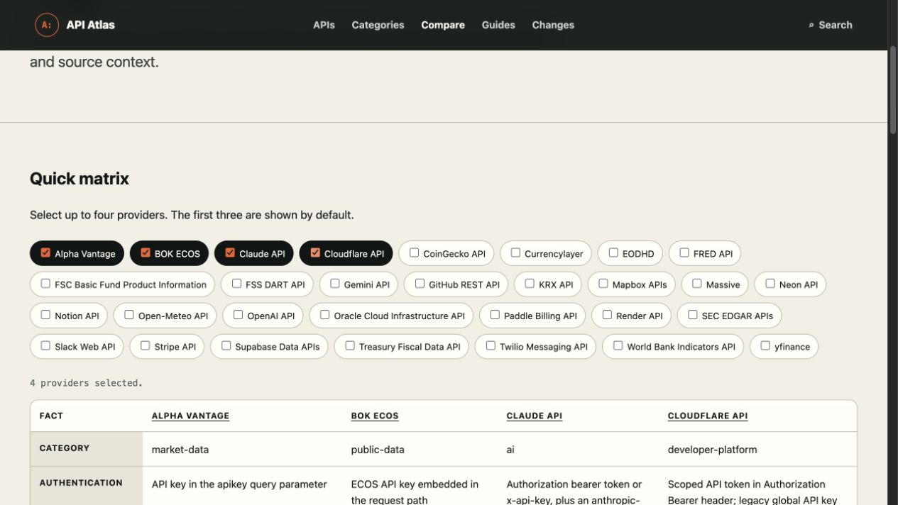
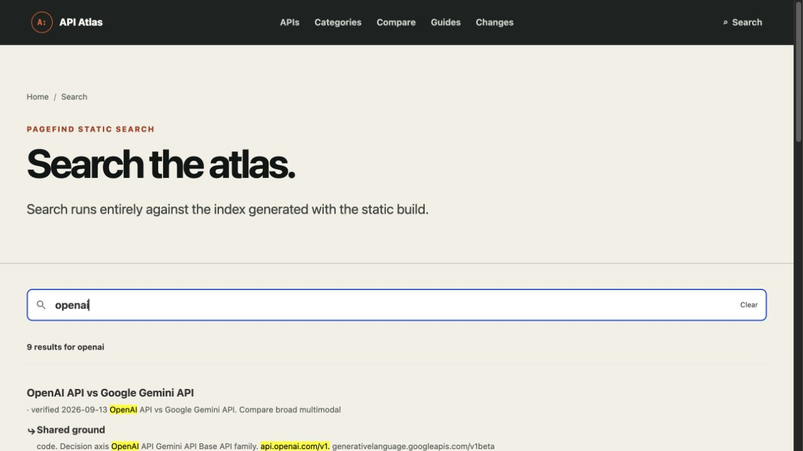

# API Atlas 미개선 항목 구현 기록

- 작성: 차도녀 gpt may
- 작성일: 2026-10-15
- 저장소: https://github.com/firewine/api-atlas
- 로컬 경로: `/Users/june/api-atlas`
- 브랜치: `main`
- 시작 HEAD: `6f48848dc384790a26d3d75fe6c948b3722b59ac`
- 감사 기준 SHA: 동일. GitHub 비교 결과 새 커밋 없음.
- 시작 상태: API Atlas 작업 트리 깨끗함. GetBeta 작업 트리의 기존 미추적 파일은 건드리지 않음.
- 최초 계약: 코드 수정과 검증까지만 수행. 후속 사용자 승인(2026-10-15)에 따라 검증된 변경의 커밋·푸시를 진행한다. PR 생성·수동 배포·운영 설정 적용은 수행하지 않는다.

## 범위와 최초 관찰

| 항목 | 시작 시 재현 | 코드 소유 | 이번 변경 |
| --- | --- | --- | --- |
| 로고·breadcrumb·공개 URL | 운영 `/api-atlas`가 `getbeta.localhost`로 301; 로고 href는 슬래시 없는 경로; 하위 경로 내부 링크 오류 | API Atlas와 별도 GetBeta 프록시 | Atlas 링크 수정; 프록시 제안만 기록 |
| Compare 선택과 열 | 운영에서 네 번째 체크 후 표는 3열 유지 | API Atlas | 외부 모듈 스크립트로 수정 |
| Search `?q=openai` | 운영 UI 비어 있음; 로컬 엄격 CSP에서 WASM 차단 재현 | API Atlas와 별도 운영 CSP | UI 초기화·오류 안내 수정; 정책 미수정 |
| 콘텐츠 검증 | 5개 프로필의 핵심 사실 20개 누락, OCI 출처 1개 미선언 | API Atlas | 공식 문서 확인 후 수정 |
| root/subpath 배포 검증 | 하위 경로에서 내부 링크 약 891개 실패 | API Atlas | 검증기와 경로 생성 수정 |

비범위: GetBeta 앱 기능, 보안 정책 적용, 기존 25개 프로필의 재감사, 프레임워크 교체. 기존 Astro `BASE_URL`, content collection, Pagefind와 현재 검증 스크립트 구조를 재사용했다.

## 작업 1 — 링크와 공개 URL: 로컬 PASS, 운영 프록시 BLOCKED

- 기준 빌드: `SITE_URL=https://getbeta.app BASE_PATH=/api-atlas/ npm run build` 종료 0, 69 HTML과 67 Pagefind 문서. 기준 `npm run verify:dist` 종료 1, 하위 경로 링크를 루트로 해석해 약 891개 실패.
- `import.meta.env.BASE_URL`의 끝 슬래시를 한 번 제거하고 경로마다 `/${route}`를 붙이도록 일치시켰다. 로고는 `/api-atlas/`, breadcrumb와 상세·비교·가이드 링크는 `/api-atlas/...`가 된다. 루트 빌드에서는 `/...`가 된다.
- 카탈로그 JSON의 `humanUrl`/`jsonUrl`, canonical, WebSite/SearchAction 및 상세 TechArticle JSON-LD, sitemap, robots, `llms.txt`, manifest 시작 경로를 각각 공개 경로에 맞췄다. 404 canonical은 실제 `404.html` 산출물과 일치시켰다.
- 실제 브라우저에서 하위 경로 KRX 상세 → 로고 클릭 결과 `http://127.0.0.1:4323/api-atlas/`; 루트 OpenAI 상세 → 로고 클릭 결과 `http://127.0.0.1:4325/`. 두 모드에서 Compare·Search·가이드 내부 링크가 해당 basepath를 유지한다.
- 운영 `curl -sSI https://getbeta.app/api-atlas/` 종료 0: 200, CSP 헤더 2개. `curl -sSI https://getbeta.app/api-atlas` 종료 0: 301 `Location: https://getbeta.localhost/api-atlas/`. 따라서 마지막 호스트 오류는 Atlas 산출물 링크와 별개로 운영 프록시에서 남아 있다. 배포 전 새 산출물에 운영 변경이 반영됐다고 주장하지 않는다.

## 작업 2 — Compare와 Search: 로컬 PASS, 운영 Search BLOCKED

### Compare

운영 기준 화면에서 Alpha Vantage/BOK ECOS/Claude 3개가 선택된 채 Cloudflare를 체크해도 표가 3열에 머물렀다. 변경 후 비교 스크립트를 같은 출처의 `/scripts/compare.js` 모듈로 제공한다. `change` 이벤트, 최대 4개 제한, 각 provider의 헤더와 데이터 셀, 상태 안내를 함께 갱신한다. Astro 인라인 스크립트 제거가 산출물에서 유지되는지 확인했다.

로컬 production build 브라우저에서 초기 3열 → Cloudflare 추가 시 상태 4개와 4열·해당 데이터 표시 → CoinGecko를 다섯 번째로 선택 시 체크 취소와 4열 유지 → 2개 선택 시 정확히 2열 → 0개에서 `Select at least two providers.` 및 데이터 열 0개를 확인했다. 키보드 Space로 OpenAI 체크도 반영됐다. 엄격한 `script-src 'self'` 로컬 응답에서도 4열 갱신을 확인했다.



### Search

기존 `processTerm`은 `?q=` 입력창을 채우는 수단이 아니며 UI 자산/검색 데이터 실패를 조용히 넘겼다. `/scripts/search.js`를 같은 출처의 모듈로 제공하고, 실제 Pagefind 검색으로 인덱스 초기화를 확인한 후 `triggerSearch(query)`를 호출한다. `baseUrl`과 `bundlePath`는 빌드 경로에서 가져온다. 상태 영역은 빈 검색어, 결과 처리, 자산 로드 실패, 검색 데이터 실패를 구분한다.

로컬 production build에서 `/api-atlas/search/?q=openai`가 9건을 표시하고 결과 링크가 모두 `/api-atlas/`를 유지했다. 루트 빌드에서는 `/search/?q=openai`가 9건을 표시하고 결과가 `/...`로 이동한다. 빈 검색어는 `Enter a search term.`, 존재하지 않는 따옴표 검색어 `"qzxjv918273645abcdxyz"`는 Pagefind `No results`를 표시했다. 직접 URL 진입과 새로고침으로 확인했다. 하위 경로의 `compare.js`, `search.js`, Pagefind JS/CSS는 HTTP 200과 JS/CSS MIME을 반환했다.

엄격한 로컬 CSP `script-src 'self'`에서는 Pagefind WASM 컴파일이 브라우저에서 차단됐다. 변경 후 검색은 무한 `Searching...` 대신 `Search data could not load...`를 표시한다. 이 상태에서 전체 검색 기능은 여전히 CSP에 의해 BLOCKED다. [Pagefind 공식 호스팅 문서](https://pagefind.app/docs/hosting/)는 엄격한 CSP에서 WASM 실행 허용이 필요함을 설명한다. 정책 변경은 사용자 담당으로 남겼다.



## 작업 3 — 콘텐츠 검증: PASS

기준 `npm run validate:content` 종료 1: FSS DART, KRX, Neon, OCI, Render의 `Base URL`, `Authentication`, `Pricing`, `Rate limits` 20개 누락과 OCI 사실 출처 미선언 1개. 검증기나 스키마는 완화하지 않았다. 다섯 프로필만 공식 자료와 2026-10-15 확인일로 수정했다. 다른 25개 프로필의 확인 날짜는 유지했다.

| 프로필 | 핵심 보정 | 확인한 공식 출처 |
| --- | --- | --- |
| FSS DART | 가상 1만 회/일을 제거. 오류 020은 일반적으로 2만 회 이상이나 개별 설정 가능. 원칙적 무료와 예외 조건 명시 | [공시검색 API](https://opendart.fss.or.kr/guide/detail.do?apiGrpCd=DS001&apiId=2019001), [이용약관](https://opendart.fss.or.kr/intro/terms.do) |
| KRX | `www.krx.co.kr/api`라는 미검증 공통 URL 제거. 승인된 서비스별 명세서, `AUTH_KEY` 헤더, 키당 하루 1만 회, 비상업적 이용·재배포 금지 명시. 가격은 약관에서 단일 금액을 확인할 수 없다고 표시 | [서비스 목록](https://openapi.krx.co.kr/contents/OPP/INFO/service/OPPINFO004.cmd), [이용 절차](https://openapi.krx.co.kr/contents/OPP/INFO/OPPINFO003.jsp), [서비스 명세 화면](https://openapi.krx.co.kr/contents/OPP/USES/service/OPPUSES002_S2.cmd?BO_ID=JvJFzlAENzZlPBDNGAWC), [약관](https://openapi.krx.co.kr/contents/OPP/INFO/OPPINFO002.jsp) |
| Neon | 관리 API URL/Bearer, 무료 플랜 단위, 분당 700회 및 버스트 예외를 구체화 | [시작 가이드](https://neon.com/docs/reference/api/get-started), [API 한도](https://neon.com/docs/reference/api/key-concepts), [가격](https://neon.com/pricing) |
| OCI | 서비스별 리전 endpoint와 서명 요청을 구분. Always Free A1의 현재 무료 테넌시 합계는 2 OCPU/12 GB로 수정. 429와 backoff 명시 | [REST API](https://docs.oracle.com/en-us/iaas/Content/API/Concepts/usingapi.htm), [Always Free](https://docs.oracle.com/en-us/iaas/Content/FreeTier/freetier_topic-Always_Free_Resources.htm) |
| Render | API URL/Bearer, 무료 웹 서비스 조건, 사용자·endpoint별 한도와 배포 훅 예외 명시 | [API](https://render.com/docs/api), [서비스 목록 API](https://api-docs.render.com/reference/list-services), [무료 웹 서비스](https://render.com/docs/free), [한도](https://api-docs.render.com/reference/rate-limiting) |

변경 후 `npm run validate:content` 종료 0: `30 providers and 137 sourced facts`. 모든 신규 mutable fact의 `sourceUrl`이 해당 `sourceUrls`에 포함된다.

## 작업 4 — 배포 산출물 검증: PASS

검증기는 소스의 비교·가이드 slug를 읽어 모든 생성 경로를 요구하고, 내부 `href`와 `src`를 빌드의 `BASE_PATH` 아래 실제 파일로 해석한다. `//` URL, basepath 이탈, 깨진 내부 링크, 잘못된 canonical/JSON-LD, 개발 origin, 카탈로그 JSON URL, provider별 실제 확인 날짜, robots/sitemap을 검사한다. 부모 GetBeta 홈페이지 링크만 명시적으로 별도 사이트로 인정한다. 가이드의 4개 비교 링크는 상대 경로로 수정했다.

| 명령 | 종료 코드 | 핵심 출력 |
| --- | ---: | --- |
| `SITE_URL=https://api-atlas.pages.dev BASE_PATH=/ npm run validate` | 0 | Astro 0 errors/0 warnings/0 hints; 69 HTML, 67 Pagefind 문서; 30 providers/137 facts; 109 필수 산출물·69 HTML 검증 |
| `SITE_URL=https://getbeta.app BASE_PATH=/api-atlas/ npm run validate` | 0 | 같은 검사 통과; 공개 루트 `https://getbeta.app/api-atlas/` |
| `git diff --check` | 0 | 공백 오류 없음 |

기존 테스트 파일은 수정하지 않았고 assertion 삭제, skip/only, 스냅샷 갱신, mock 확대는 없다. `scripts/validate-content.mjs`의 필수 조건도 바꾸지 않았다. 브라우저 상호작용은 빌드된 정적 결과물을 로컬에서 서빙해 수동 검증했다. 별도 자동 브라우저 러너는 저장소에 없으므로 신규 자동 브라우저 테스트는 추가하지 않았다.

표시 숫자는 홈에서 30개 provider, 8개 category, 7개 guide를 content collection에서 계산한다. README의 프로필 수를 30으로 고쳤고, 8개 category에 맞게 제목을 수정했다. 푸터는 전체 카탈로그 재검토일로 오해되지 않도록 `Latest profile verification`을 실제 프로필 날짜 최대값으로 계산한다. 빌드 날짜를 확인 날짜로 사용하지 않는다.

## 변경 파일과 경계

- URL/SEO: `src/layouts/BaseLayout.astro`, `src/lib/content.ts`, `src/pages/**`, `src/components/ProviderCard.astro`, `public/site.webmanifest`.
- 동작: `src/pages/compare/index.astro`, `src/pages/search/index.astro`, 새 `public/scripts/compare.js`, `public/scripts/search.js`.
- 콘텐츠: 다섯 `src/data/apis/{fss-dart,krx,neon,oci,render}.md`, 두 `src/data/guides/choose-*.md`.
- 검증·문서: `scripts/verify-dist.mjs`, `README.md`, 이 구현 기록과 두 브라우저 증거 이미지.

## 운영 프록시·정책: 별도 변경 후보, 미적용

2026-10-15 운영 `/api-atlas/` 응답은 CSP 두 개를 보낸다. 하나는 `script-src 'self'`, 다른 하나는 `script-src 'self' 'unsafe-inline'`이며 브라우저는 둘 다 집행한다. Atlas의 `public/_headers` 한 파일만으로 이 운영 응답을 판단할 수 없다. GetBeta 저장소의 `deploy/Caddyfile`은 전역 CSP와 `header_up Host getbeta.localhost`를, `frontend/nginx.conf`는 전역 CSP를 포함한다. 배포 중인 구성 파일·이미지의 SHA는 확인하지 못했다. 두 계층 모두 Atlas 경로의 CSP 예외 적용 여부를 점검해야 한다.

다음은 운영 담당자가 배포 구성 확인 후 적용·시험할 **제안 방향**이며 이 작업에서는 파일을 수정하지 않았다.

```diff
# GetBeta deploy/Caddyfile
- 전역 header 블록에서 Content-Security-Policy를 모든 경로에 추가
+ /api-atlas 및 /api-atlas/* 이외의 경로에만 기존 Content-Security-Policy 추가
+ /api-atlas -> /api-atlas/ 를 공개 호스트에서 먼저 308 정규화

# GetBeta frontend/nginx.conf
- $content_security_policy_header를 모든 URI에서 같은 값으로 설정
+ /api-atlas 및 하위 URI에서는 빈 값, 나머지는 기존 값으로 매핑
+ 내부 리다이렉트 후에도 Atlas 응답에 CSP가 다시 붙지 않는지 검증
```

`header_up Host getbeta.localhost`와 슬래시 없는 요청의 301 Location 사이에는 연관 가능성이 있으나, 운영 프록시 체인의 실제 원인으로 단정하지 않는다. 정책 적용 후 `curl -I`로 0개 CSP 및 올바른 Location을 확인하고 브라우저에서 검색 WASM·결과를 다시 확인해야 한다. 다른 GetBeta 경로의 기존 보안 정책은 유지되어야 한다.

## 최종 판정

- **코드·로컬 산출물: PASS.** 루트와 하위 경로 전체 검증 및 브라우저의 로고·Compare·Search 동작을 확인했다.
- **운영 반영: UNVERIFIED.** 배포하지 않았다.
- **운영 정책/리다이렉트: BLOCKED.** 운영 응답에 중복 CSP와 `getbeta.localhost` 301이 남아 있다. Atlas 코드만으로 운영 검색의 WASM 실행을 보장할 수 없다.
- **후속 승인:** 사용자가 2026-10-15에 커밋·푸시를 승인했다. 이 기록을 포함한 검증된 변경을 원격 `main`에 게시한다. PR 생성·수동 배포·운영 설정 적용은 수행하지 않는다.
